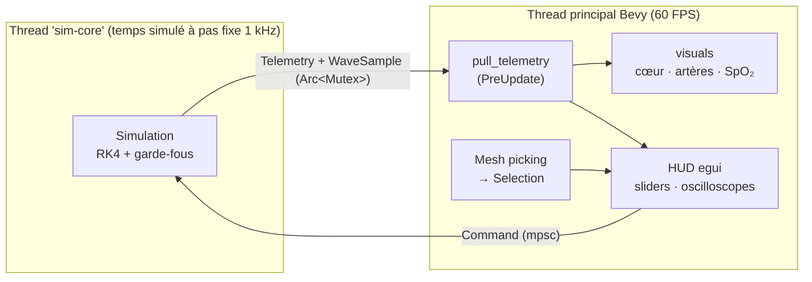

# Architecture — Homo Digitalis (Phases 1 & 2)

> Simulateur théorique à but éducatif et scientifique — **pas un dispositif médical**.

## 1. Vue d'ensemble



Règle d'or : **`sim-core` ne dépend ni de Bevy ni du GPU**. Il est déterministe
(deux exécutions identiques donnent le même état bit à bit — test `simulation_is_deterministic`)
et testable en CI sans fenêtre.

| Crate | Rôle |
|---|---|
| `crates/sim-core` | Solveur RK4, modèle hémodynamique, gaz, Poiseuille, garde-fous, snapshots/rewind, télémétrie |
| `crates/homo-app` | Bevy 0.15 + bevy_egui : rendu, caméra orbitale, calques, picking, HUD, thread runner |

### Pourquoi `sim-core` n'utilise pas directement l'ECS de Bevy
Les composants de la spec (`OrganCompartment`, `MuscleBundle`) arriveront en phases 3-4 dans
`sim-core` sous forme de tableaux contigus (structure-of-arrays) pour la localité de cache et la
parallélisation Rayon. Bevy ne porte que la **présentation** (entités = pièces anatomiques ;
composants `AnatomyLayer`, `Organ`, `BaseColor`…). Cela garde le noyau exécutable en 1 kHz sur un
thread dédié, sans dépendre de la cadence de rendu.

### Boucle de temps
`Simulation::advance(sim_seconds, dt, max_steps)` accumule le temps réel × facteur d'accélération
et exécute des pas fixes. `dt = 1 ms` jusqu'à 60×, `2 ms` au-delà (`recommended_dt`). Le budget
`max_steps` est plafonné : en cas de retard, le surplus est abandonné (pas de spirale de la mort).

## 2. Module A — modèle hémodynamique 0D en boucle fermée

Vecteur d'état (8 composantes, `hemodynamics.rs`) :

| Indice | Variable | Unité |
|---|---|---|
| `V_LV` | volume du ventricule gauche | mL |
| `V_ART` | volume contraint artériel (Windkessel) | mL |
| `V_VEN` | volume contraint veineux | mL |
| `PHASE` | phase du cycle cardiaque | 0..1 |
| `SYMP`, `PARA` | tonus sympathique / vagal | 0..1 |
| `MAP_FILT` | PAM filtrée (capteur baroréflexe) | mmHg |
| `ADREN` | adrénaline plasmatique | unités normalisées |

```text
VG ──Rc──▶ [C_art] ──Rp──▶ [C_ven] ──Rmv──▶ VG
```

Équations (valves = diodes) :

```
P_lv   = max(0, E(t)·(V_lv − V0))        E(t) = Emin + (Emax − Emin)·e(φ)
P_art  = V_art / C_art                   P_ven = max(0, (V_ven + Δshift) / C_ven)
Q_out  = max(0, P_lv − P_art) / Rc
Q_per  = max(0, P_art − P_ven) / Rp
Q_in   = max(0, P_ven − P_lv)  / Rmv

dV_lv/dt  = Q_in  − Q_out
dV_art/dt = Q_out − Q_per − hémorragie
dV_ven/dt = Q_per − Q_in
```

Le Windkessel à 3 éléments est ici `Rc` (impédance caractéristique) + `C_art` + `Rp`, couplé à un
réservoir veineux et à un VG à élastance variable (Suga) : la **loi de Frank-Starling émerge**
sans être codée. La masse sanguine est conservée exactement (test `blood_mass_is_conserved…`).

- **Activation** `e(φ)` : demi-sinus sur la durée de systole `Ts = 0,37·√T` (T = 60/FC).
- **Nœud sinusal** : `FC = 70 + 110·(S_eff − 0,3) − 45·(Vg − 0,6)` borné à 30–220 bpm.
- **Vasomotricité (Poiseuille)** : `Rp = Rp0 · (η/η0) · (r0/r)⁴ · …` ; `r` baisse avec le tonus
  sympathique ; effort et hypoxie ajoutent une vasodilatation locale.
- **Baroréflexe** : sigmoïdes sur la PAM filtrée (τ = 2 s) → cibles sympathique (↓ avec P)
  et vagale (↑ avec P) ; retards τ_S = 4 s, τ_V = 1 s.
- **Chémoréflexe** : l'hypoxie (SpO₂ < 95 %) augmente le sympathique et diminue le vagal.
- **Transport gazeux** (`gas.rs`) : altitude → pression barométrique → PiO₂ → PaO₂/PaCO₂ avec
  réponse ventilatoire hypoxique → SpO₂ par l'équation de Severinghaus.
- **Événements** : hémorragie (débit mL/s, proportionnel à la pression), choc anaphylactique
  (`vasodilation_factor` < 1), déshydratation (`viscosity_factor` > 1), effort, altitude, bolus
  d'adrénaline (décroissance τ = 170 s).

### Garde-fous (critère « ne jamais diverger »)
1. `Inputs::sanitized()` : NaN/Inf → valeur par défaut, bornes physiologiques.
2. Sigmoïdes à saturation (`safety.rs`), résistances et fréquences bornées.
3. `clamp_state` : bornes dures sur chaque variable d'état.
4. Après chaque pas : si le résultat n'est pas fini → retour à l'état précédent et statut
   `NumericalFault` (modèle figé).
5. Arrêt biologique : PAM filtrée < 20 mmHg pendant 15 s → `CardiacArrest` (FC = 0, relaxation passive).

### Snapshots / Rewind
`SnapshotRing` : copie de l'état (états, statut, entrées, volume perdu) toutes les 5 s simulées,
720 entrées (1 h de recul). `Simulation::rewind(s)` restaure le snapshot antérieur le plus proche.

## 3. Phase 1 — rendu et interaction

- **Calques** (`layers.rs`) : 6 `AnatomyLayer`, opacité 0–1 ; < 2 % → `Visibility::Hidden` ;
  < 100 % → `AlphaMode::Blend`. Sous 60 % une couche est *fantôme* (non sélectionnable) pour cliquer
  « à travers » la peau/les muscles.
- **Picking** : `MeshPickingPlugin` + observer `Pointer<Click>` → ressource `Selection`.
- **Caméra** : orbite (clic droit), pan (clic milieu), zoom (molette), lissage exponentiel
  indépendant du framerate.
- **Anatomie** : pièces procédurales nommées en nomenclature anatomique, **à remplacer** par les
  glTF Z-Anatomy/BodyParts3D (voir `ASSET_PIPELINE.md`).
- **Shaders physiologiques (Phase 2)** : le cœur change d'échelle avec `lv_volume_ml`, les artères
  pulsent avec la pression, la couleur du sang interpole HbO₂ ↔ Hb selon la SpO₂.

## 4. Écarts connus avec la spécification (à traiter)

| Spec | État actuel | Prévu |
|---|---|---|
| Graphe artériel 1D | Un seul Windkessel 0D ; `VesselSegment` + Poiseuille prêts | Phase 2b : graphe d'artères, sténose locale |
| Particules GPU de flux sanguin | non implémenté | Phase 2b (compute shader wgpu) |
| Morph targets cardiaques | échelle uniforme animée | avec les maillages glTF |
| Shaders X-Ray dédiés | alpha-blending PBR standard | Phase 5 (polissage) |
| Maillages Z-Anatomy | primitives procédurales | Phase 1b (pipeline Blender) |
| Température / humidité / gravité | sliders affichés, désactivés | Phase 5 |
| Budget < 4 ms/frame, 60 FPS 1440p | non mesuré (sim sur thread séparé) | profilage Tracy à ajouter |

## 5. Calibration et validation

Les paramètres ont été calibrés avec un prototype Python indépendant avant le portage en Rust
(repos : FC ≈ 75 bpm, PA ≈ 110/73 mmHg, DC ≈ 4,8 L/min ; effort 0,8 : FC ≈ 123, DC ≈ 13 L/min ;
altitude 8848 m : SpO₂ ≈ 38 % ; hémorragie 20 mL/s : choc progressif). Les tests de
`sim-core` vérifient ces comportements avec des bornes larges. **Ce n'est pas une validation
clinique.**
